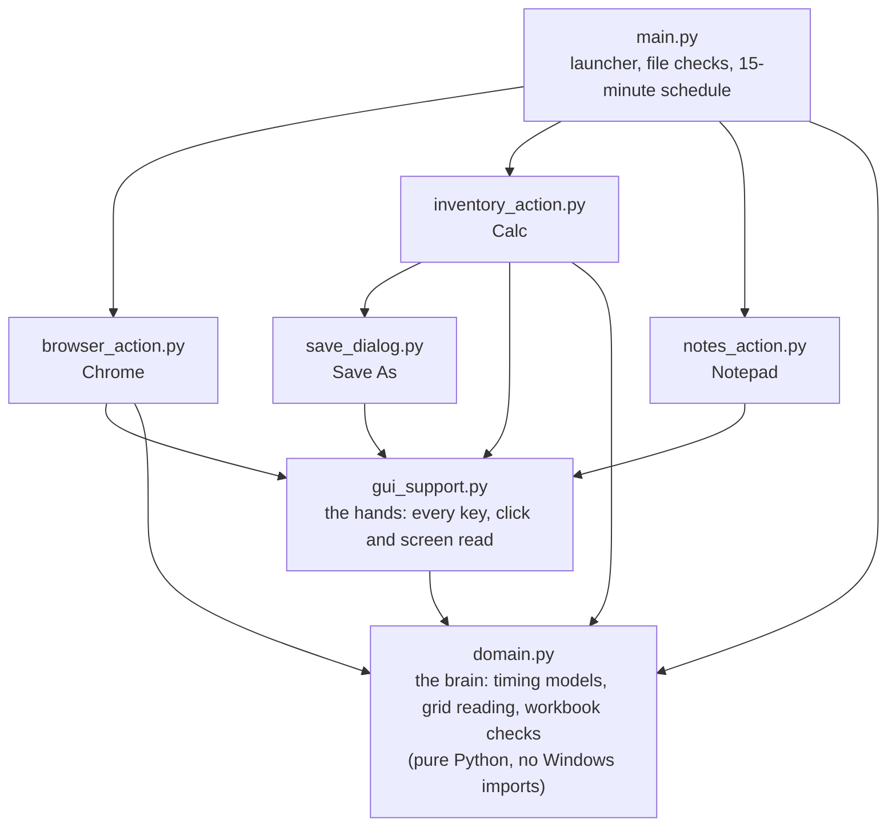

<div align="center">

# 🏆 Champions out of 30 teams

**NTU × ST Engineering Hackathon 2026** · "Synthetic Human Agent" challenge

</div>

A Python agent that sits at a Windows 11 computer and does fifteen minutes of ordinary office
work the way a person would. It reads news sites in Chrome, builds a stock-inventory
spreadsheet in OpenOffice Calc, and types a short account of the session in Notepad, ending
with the line `END`. Nobody touches the keyboard.

The hard part is that it was judged from the system logs, not just the screen. A security
reviewer reading Sysmon, Process Explorer and Event Viewer should see a person at work: apps
started from their icons, human timing, and no trace of a script.

**It starts like a person, moves like a person, and works like a person.**

## Demo

https://github.com/user-attachments/assets/91e0d37a-fee1-4572-a82f-7644d8d3cf14

The three-minute version shown at the finals, recorded uncut and in real time on the
organisers' VM: the same three jobs as the full run, with three spreadsheet records instead
of seven.

## The challenge

The agent runs unattended on an air-gapped Windows 11 VM supplied by the organisers and has
to finish inside 15 minutes. Entries were scored on **process authenticity** (30%), **human
entropy and timing** (30%), **complexity of action** (20%) and **resource efficiency** (20%):
who started each program, is the timing human, is it doing real work across apps, and is it
light on the machine?

What stood in the way:

- **Calc is invisible to automation.** OpenOffice Calc 4.1 tells Windows nothing about its
  cells, menus or Name Box, so the sheet has to be read from the screen.
- **The web fights back.** Certificate warnings (some with no way through), cookie banners,
  offer pop-ups, and pages that load blank.
- **A hard 15-minute limit** that has to hold even when the VM runs slow.

## Naive script vs this agent

| What a reviewer checks | A naive script | This agent |
|---|---|---|
| Who started the apps? | `python.exe` launches `chrome.exe` | `explorer.exe`: every app is double-clicked from its desktop icon |
| Typing rhythm | `sleep()` with identical gaps | Gaps vary with a spread (CV) of 0.59; real copy-typists sit near 0.47 |
| Pointer | Straight line at constant speed | Fast out, slow in, and sometimes misses and corrects |
| Files on disk | Logs and screenshots | None. No logs, no cache, not even `__pycache__`; only Calc saves the workbook |

## How it works

### Starts like a person

The agent is started from a desktop shortcut (`pythonw.exe`, so no console window) and opens
Chrome, Calc and Notepad by double-clicking their icons. Explorer is the parent of every app,
which is what Sysmon shows for a real user. It never calls `subprocess`, `os.startfile` or
COM, and writes no files of its own during a run. Before any input it checks every file
against a SHA-256 manifest, so a bad copy stops before Chrome opens.

### Moves like a person

Each pointer move follows a minimum-jerk speed curve (Flash & Hogan, 1985): it peaks early,
then eases onto the target. How long a reach takes follows Fitts' law, so further or smaller
targets take longer, with random variation on every move. About 40% of long moves land
slightly off and correct, and the path has a small bow, tremor and uneven sampling.

### Pauses like a person

Every pause (hovering before a click, reading a page) is drawn from a lognormal
distribution: most are short and a few run long. Studies of how long people stay on web
pages show the same long tail (Liu et al., 2010; Nielsen, 2011). A flat random range is not
enough; chat bots with uniformly random delays were still caught by entropy tests
(Gianvecchio et al., 2008). Each run is a new person: pace, scroll speed, typo rate and pause
length are drawn fresh at the start.

### Types like a person

Key gaps depend on what comes next: 0.12–0.30 s between letters, longer after a space, longer
still before a symbol. Each word gets its own pace, and capitals use a real held Shift. Slips
land only on neighbouring QWERTY keys and are noticed and fixed about half a second later,
never inside a formula or a file path. The resulting variability was checked against Aalto's
136-million-keystroke study (Dhakal et al., 2018).

### Works like a person

- **Reads Calc from pixels.** From one screen capture it finds the blue highlighted row and
  column headers and the 1-px grid lines, then rebuilds an even grid so one hidden line can't
  misnumber every cell after it. It clicks cells, drags or Shift-clicks ranges, and rechecks
  the headers before typing, with a keyboard fallback if the grid is lost.
- **Checks its own work.** After saving, it opens the `.ods` file and verifies the records,
  the total and the budget result.
- **Handles a messy web.** On a certificate warning it checks the site name, then clicks
  Advanced and Proceed, or skips the site if there is no Proceed. It accepts cookie consent,
  closes offers with their X, types addresses, opens tabs, searches within pages, and never
  counts a page it couldn't read as read.
- **Keeps to time.** Each app has a hard deadline. Calc does the essentials first and
  polishes only if time allows, and the notes are chosen line by line to fit the typing
  speed measured during the run, so `END` always lands inside 15 minutes.

## Results from the final VM run

| | |
|---|---|
| Every task finished | **14 min 15 s** of the 15 minutes |
| Homepages read | **4**, plus asana.com skipped because its warning had no Proceed link |
| Workbook | **7 records, SGD 3,486 total**, within budget, saved and checked from the file |
| Agent CPU and memory | **0.11%** average CPU (peak 0.86%), about **60 MB** (measured on an earlier VM run) |
| Files written by the agent | **0**; only Calc writes, when it saves the workbook |

Timeline: Chrome opens at 0:08 → searches CNN at 2:49 → Calc at 4:41 → 7 records in by
8:59 → formatted and sorted by 11:12 → Notepad at 12:17 → `END` at 14:15.

## Architecture



One orchestrator runs the schedule and hands over to three task modules in turn. Nearly
every key, click and screen read goes through one module, the hands, so everything is
human-timed in one place, and it is real OS-level input rather than control from inside the
browser. The decision logic lives in a separate brain with no Windows code, which is why
the whole agent (about 4,800 lines in 7 modules) runs under 470 tests on any laptop.

Alongside the modules: `config.json` (homepages, phase lengths, probabilities and shortcut
names), `inspect_ui.py` (optional diagnostics of what Calc and Chrome expose to UI
Automation), `tests/` (the offline suite and the Calc simulator) and `tools/make_zip.py`
(builds the VM package and `BUILD.json`).

## Every VM failure became a fix

We couldn't drive the organisers' VM directly, so each of seven test rounds was
screen-recorded and analysed frame by frame. Every problem got a fix and a test that
reproduces it:

| What broke | What changed |
|---|---|
| Spreadsheet ranges never selected | Read the grid from pixels; send arrows as extended keys |
| Ctrl+D opened a selection list instead of filling down | Copy and paste formulas |
| A mouse resting on the host moved the VM's pointer | Recheck the pointer before every click |
| The workbook saved into the wrong folder | Steer the Save dialog to the Desktop; never answer "replace" outside it |
| A bad file copy crashed a run | Check every file against `BUILD.json` before any input |
| Sysmon showed the agent writing log files | Removed all file output |
| The notes were cut off mid-line | Choose lines to fit the measured typing speed |

The round-by-round notes are in [DEVLOG.md](DEVLOG.md).

## Limits

- The agent's own `pythonw.exe` is visible in the process tree, as a child of Explorer.
- Windows marks software-generated input as injected (`LLKHF_INJECTED`), so a low-level hook
  can tell it apart. A hardware input device would close this gap.
- Keys never overlap: each is released before the next is pressed, while fast typists often
  roll over.
- Grid reading is tuned to the VM's 1280×800 screen and Calc's default theme; display
  scaling is untested. If the grid can't be read, the agent falls back to the keyboard.

## Running it

### Offline tests (any OS)

The tests fake pyautogui, pywinauto and pywin32, and simulate OpenOffice Calc with its
quirks, a simulated clock and a slowness factor. All 470 run in about 12 seconds:

```bash
python3 -B -m unittest discover -s tests
```

### On the Windows VM

1. Install Python 3.12 and the dependencies: `pip install -r requirements.txt`.
2. On any machine, build the package with `python3 tools/make_zip.py`. It writes the agent
   files plus `BUILD.json`, the SHA-256 manifest the agent checks before it starts.
3. Unzip it into a folder on the VM, then run `create_shortcut.ps1` once to put a launcher
   shortcut on the desktop.
4. Put shortcuts named **Google Chrome**, **OpenOffice Calc** and **Notepad** on the desktop
   (names are set in `config.json`; without the Notepad one, Win+R is used).
5. Double-click the launcher and choose **Full demo**. Press **F8**, or move the pointer into
   a screen corner, to stop.

## Related work

CMU SEI's GHOSTS (Updyke et al., 2018) is the best-known synthetic-user framework. Its
Windows client starts Office through COM and the browser through Selenium, so a reviewer
sees automation, not Explorer, as the parent, and it enters text in one call rather than key
by key. Detection research on browser agents (Choudhary et al., 2026) finds that automation
driven from inside the page lacks the raw pointer and wheel streams real input produces.
Activity simulators are judged on when actions happen as much as what they are (Lamp et al.,
2025), which is why timing gets as much care here as the tasks.

## References

- Fitts, P. M. (1954). The information capacity of the human motor system in controlling
  the amplitude of movement. *Journal of Experimental Psychology*, 47(6).
- Flash, T. & Hogan, N. (1985). The coordination of arm movements: an experimentally
  confirmed mathematical model. *Journal of Neuroscience*, 5(7).
- Dhakal, V., Feit, A. M., Kristensson, P. O. & Oulasvirta, A. (2018). Observations on
  typing from 136 million keystrokes. *CHI 2018*.
- Nielsen, J. (2011). How long do users stay on web pages? Nielsen Norman Group.
- Liu, C., White, R. W. & Dumais, S. (2010). Understanding web browsing behaviors
  through Weibull analysis of dwell time. *SIGIR 2010*.
- Gianvecchio, S., Xie, M., Wu, Z. & Wang, H. (2008). Measurement and classification of
  humans and bots in Internet chat. *USENIX Security 2008*.
- Updyke, D. D., Dobson, G. B., Podnar, T. G., Osterritter, L., Earl, B. L. & Cerini,
  A. D. (2018). GHOSTS in the Machine: A framework for cyber-warfare exercise NPC
  simulation. *CMU/SEI-2018-TR-005*, Carnegie Mellon University.
- Choudhary, V., Schmidt, L., Kenntner, A. Z., Skhab, F., Osswald, M. & Ernstberger, J.
  (2026). What does it take to detect an AI agent? Minimal feature sets for behavioral
  detection under browser automation. *arXiv:2607.26935*.
- Lamp, S., Hiser, J. D., Nguyen-Tuong, A. & Davidson, J. W. (2025). PHASE: Passive
  human activity simulation evaluation. *arXiv:2507.13505*.

## Built with

- [PyAutoGUI](https://pyautogui.readthedocs.io/) for pointer and keyboard input.
- [pywinauto](https://pywinauto.readthedocs.io/) for reading window and control state
  through UI Automation.
- [pywin32](https://pypi.org/project/pywin32/) for Win32 calls: window handles, key state,
  the clipboard and screen capture.
- The Python standard library, including tkinter for the launcher.

## Team

Ryan Lim · Aniket Majee · Ethan Kok · Lai Longze · Matthew Lim
