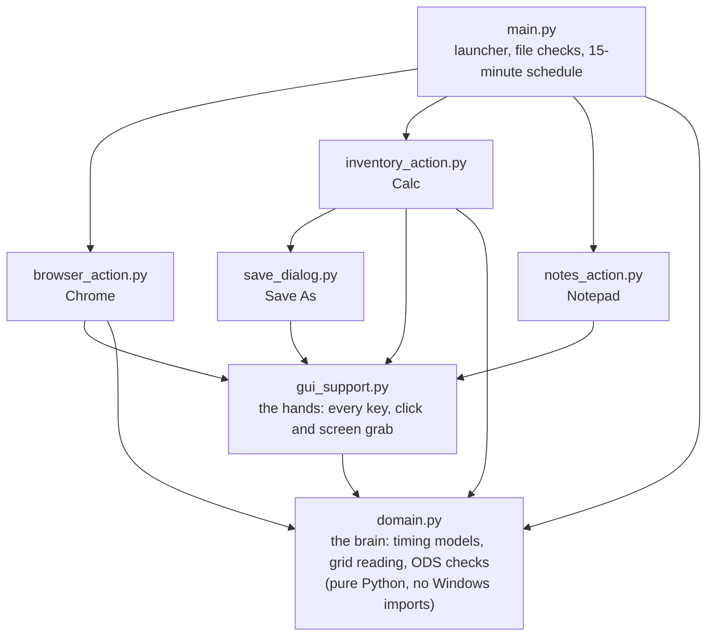

# Synthetic Human Agent

A Python agent that sits at a Windows 11 desktop and does fifteen minutes of ordinary
office work the way a person would: it browses news sites in Chrome, builds a stock
inventory in OpenOffice Calc, and types up what it did in Notepad. It is built to look
human on screen and in the system telemetry a security analyst reads (Sysmon, Process
Explorer, Event Viewer).

Team 21's entry to the **NTU × ST Engineering 2026 hackathon**, "Synthetic Human Agent"
challenge, where it was selected as one of six finalists.

## Demo

<!-- Demo video: replace this comment with the video link or an embedded player. -->
> **Demo video:** a complete run in the agent's three-minute demo mode, recorded in real
> time and uncut. Link to be added.

## The challenge

On an air-gapped Windows 11 VM supplied by the organisers, the agent must, with no one
touching the keyboard and inside 15 minutes:

1. **Browse:** read news and tech homepages in Chrome (mock sites, many behind certificate warnings).
2. **Build:** make, format and save a stock-inventory spreadsheet in OpenOffice Calc.
3. **Write:** type a short account of the session in Notepad, ending with `END`.

Entries were judged on telemetry, not just on what appears on screen: **process
authenticity** (30%), **human entropy and timing** (30%), **complexity of action** (20%)
and **resource efficiency** (20%).

## Results from the final VM run

| | |
|---|---|
| Every task finished | **14 min 15 s** of the 15 minutes |
| Homepages read | **4**, plus one skipped because its warning had no Proceed link |
| Workbook | **7 records, SGD 3,486 total**, within budget, saved and checked from the file |
| Agent CPU | **0.11%** on average, peak 0.86%, about 60 MB of memory (measured on an earlier VM run) |
| Files the agent writes | **0**; only Calc writes, when it saves the workbook |

Timeline: Chrome opens at 0:08 → searches CNN at 2:49 → Calc at 4:41 → 7 records in by
8:59 → formatted and sorted by 11:12 → Notepad at 12:17 → `END` at 14:15.

## How it passes for a person

### In the process tree

| What a reviewer checks | A naive script | This agent |
|---|---|---|
| Who started the apps? | `python.exe` launches `chrome.exe` | `explorer.exe`: every app is opened by double-clicking its desktop icon |
| Typing rhythm | `sleep()` with identical gaps | Gaps vary (CV 0.59; real typists ≈ 0.47) |
| Pointer | Straight line, constant speed | Fitts-timed reach that eases in and sometimes corrects |
| Files on disk | Logs and screenshots | None. No logs, no cache, not even `__pycache__` |

The agent itself is started from a desktop shortcut (`pythonw.exe`, so no console
window). It never calls `subprocess`, `os.startfile` or COM to launch anything.

### In its timing

- **Pointer.** Each reach follows a minimum-jerk velocity profile (Flash & Hogan, 1985):
  fast out, long slow approach. Its duration follows Fitts' law, tuned against a manual
  screen recording on the VM, with lognormal noise per move. About 40% of long
  moves land slightly off target and correct, and samples have small tremor and
  irregular spacing.
- **Pauses.** Every pause between actions (hovering before a click, reading a page,
  glancing at the source list) is drawn from a lognormal distribution, so most are
  short and a few run long, the long tail seen in studies of how long people stay on
  web pages.
- **Typing.** Gaps depend on the next key: 0.12–0.30 s between letters, 0.25–0.65 s
  after a space, 0.35–0.95 s before a symbol. Each word gets its own pace, capitals use
  a real held Shift, and slips land only on neighbouring QWERTY keys before being
  noticed and corrected. We checked the resulting variability against Aalto's 136
  million-keystroke study (Dhakal et al., 2018).
- **A new person every run.** Pace, scroll speed, typo rate, pause length and the order
  of the 27 homepages are drawn fresh at the start of each run.

### In the work itself

- **Reading Calc from pixels.** OpenOffice Calc 4.1 exposes no cells, menus or Name Box
  to Windows UI Automation. From a single GDI BitBlt of the screen, the agent finds the
  blue highlighted headers and the 1-px grid lines, and rebuilds an even grid. It then
  clicks cells, drags ranges or Shift-clicks them, and rechecks the headers before
  typing.
- **Checking its own output.** After saving, it opens the `.ods` file as a ZIP and
  verifies the records, the total and the budget result.
- **Handling a messy web.** It checks the hostname on a certificate warning before
  choosing Advanced → Proceed, skips the site if there is no Proceed, accepts cookie
  consent, closes offers with their X, and never counts an unreadable page as read.
- **Keeping to time.** Each phase has a hard deadline. Calc does the essentials first
  and polishes only if time allows. The notes are chosen line by line to fit the typing
  speed measured during the run, with time reserved for the closing `END`.

## Architecture



Nearly all input goes through one module, `gui_support.py`, so everything the agent does
is human-timed in one place. The decision logic lives in `domain.py` with no Windows
dependencies, which is why the whole agent runs under test on any OS.

## Built on the VM, one failure at a time

The agent went through seven recorded rounds on the organisers' VM. Each failure became
a fix and a regression test:

| What broke | What changed |
|---|---|
| Spreadsheet ranges never selected | Read the grid from pixels; send arrows as extended keys |
| Ctrl+D opened a selection list instead of filling down | Copy and paste formulas |
| A mouse resting over the VM console moved the agent's pointer | Recheck the pointer before every click |
| The workbook saved into the wrong folder | Steer the Save dialog to the Desktop, never answer "replace" outside it |
| A bad file copy crashed a run | Compare every file against `BUILD.json` before any input |
| Sysmon showed the agent writing log files | Removed all file output |
| The notes were cut off mid-line | Choose lines to fit the measured typing speed |

The full round-by-round notes are in [DEVLOG.md](DEVLOG.md).

## Running it

### Offline tests (any OS)

The tests fake pyautogui, pywinauto and pywin32, and simulate OpenOffice Calc with its
quirks, a simulated clock and a slowness factor.

```bash
python3 -B -m unittest discover -s tests
```

470 tests, about 12 seconds.

### On the Windows VM

1. Install Python 3.12 and the dependencies: `pip install -r requirements.txt`.
2. On any machine, build the package with `python3 tools/make_zip.py`. It writes the
   agent files plus `BUILD.json`, a SHA-256 for each `.py` file and `config.json`, which
   the agent checks before it starts.
3. Unzip it into a folder on the VM, then run `create_shortcut.ps1` once to put a
   launcher shortcut on the desktop.
4. Put desktop shortcuts named **Google Chrome**, **OpenOffice Calc** and **Notepad** on
   the desktop (names are set in `config.json`; without the Notepad one, Win+R is used).
5. Double-click the launcher and choose **Full demo**. Press **F8**, or move the pointer
   into a screen corner, to stop.

## Repository layout

| File | Role |
|---|---|
| `main.py` | Launcher, preflight checks and the phase schedule |
| `browser_action.py` | Chrome: typed addresses, certificate warnings, consent, reading, find-in-page |
| `inventory_action.py` | Calc: grid reading, data entry, formulas, formatting, sorting, saving |
| `notes_action.py` | Notepad: the run summary, ending with `END` |
| `save_dialog.py` | The Windows Save dialog, driven by clicks |
| `gui_support.py` | The only place input is produced: pointer, clicks, typing, screen grabs |
| `domain.py` | Pure logic: timing models, grid detection, ODS validation |
| `config.json` | Homepages, phase lengths, probabilities and shortcut names |
| `inspect_ui.py` | Optional diagnostics: what Calc or Chrome exposes to UI Automation |
| `tests/` | Offline test suite and the Calc simulator |
| `tools/make_zip.py` | Builds the VM package and `BUILD.json` |

## Limits

- The agent's own `pythonw.exe` is visible in the process tree, as a child of Explorer.
- Input is generated in software, and Windows marks software input as injected
  (`LLKHF_INJECTED`), so a low-level hook can tell it apart. A hardware input device
  would close this gap.
- Grid reading is tuned to the VM's 1280×800 screen and Calc's default theme. If the
  grid can't be read, the agent falls back to the keyboard.

## References

- Fitts, P. M. (1954). The information capacity of the human motor system in controlling
  the amplitude of movement. *Journal of Experimental Psychology*, 47(6).
- Flash, T. & Hogan, N. (1985). The coordination of arm movements: an experimentally
  confirmed mathematical model. *Journal of Neuroscience*, 5(7).
- Dhakal, V., Feit, A. M., Kristensson, P. O. & Oulasvirta, A. (2018). Observations on
  typing from 136 million keystrokes. *CHI 2018*.
- Nielsen, J. (2011). How long do users stay on web pages? Nielsen Norman Group.

## Team 21

Ryan Lim · Aniket Majee · Ethan Kok · Lai Longze · Matthew Lim
